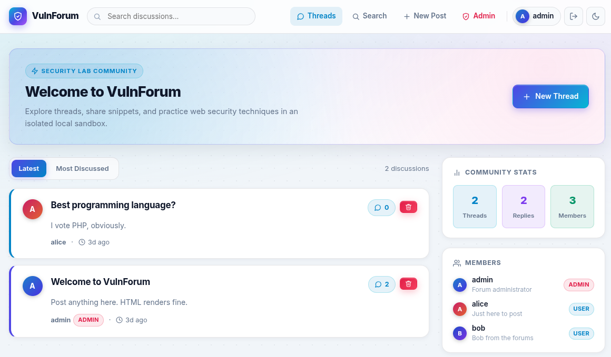

# VulnForum — Vulnerable Classic LAMP-Stack Forum Lab

[](https://www.docker.com/)
[](https://www.php.net/)
[](https://httpd.apache.org/)
[](https://www.mysql.com/)
[](#license--legal-notice)

**VulnForum** is an intentionally vulnerable classic LAMP-stack discussion forum built with vanilla PHP 8.2, Apache 2.4, and MySQL 8.0 to demonstrate legacy web application flaws, offensive attack chains, and defensive remediation practices in a self-contained Docker lab.



> [!CAUTION]
> **DISCLAIMER: FOR EDUCATIONAL AND LAB USE ONLY**
> This application contains **19+ intentional critical vulnerabilities** (including direct `eval()` RCE, arbitrary PHP webshell upload, PHP Object Injection, LFI, SQL Injection, and Stored/Reflected XSS). **Never deploy or expose this application to the public internet or untrusted networks.** Run only within isolated local or lab environments.

---

## Table of Contents

- [Features](#features)
- [Architecture & Project Structure](#architecture--project-structure)
- [Quick Start & Operations](#quick-start--operations)
- [Seeded Credentials & Database](#seeded-credentials--database)
- [Deliberate Vulnerabilities Overview](#deliberate-vulnerabilities-overview)
- [Companion Lab Listener (`attacker_server.py`)](#companion-lab-listener-attacker_serverpy)
- [Example Attack Chain & Practice Workflow](#example-attack-chain--practice-workflow)
- [License & Legal Notice](#license--legal-notice)

---

## Features

- **Discussions**: Create threads, browse and sort by *Latest* or *Most Discussed*, search titles and bodies, post replies, and delete threads or replies (available to the post author or admins).
- **Accounts & Profiles**: User registration, login with "Remember me" cookie, password-recovery token flow, and a profile page supporting avatar uploads stored under `/uploads/` and persisted in `users.avatar` (with automatic schema migration on startup).
- **Admin Panel**:
  - **Users Directory** (`/admin/users.php`): KPI overview, live table filtering, credential/token inspection, and FK-safe user deletion.
  - **Template Preview** (`/admin/eval.php`): Interactive PHP expression sandbox with presets.
- **UI & Usability**: Responsive dark/light theme switcher (persisted in `localStorage`), confirmation prompts on destructive actions, and inline lab hints on key pages.

---

## Architecture & Project Structure

| Component | Technology | Container / Process | Internal Port | Host Port |
| :--- | :--- | :--- | :--- | :--- |
| **Web Server / App** | PHP 8.2 (`mod_php`) + Apache 2.4 | `vulnforum-web` | `80` | `8082` |
| **Database** | MySQL 8.0 | `vulnforum-db` | `3306` | `3307` |
| **XSS Receiver (Optional)** | Python 3 + Flask | `attacker_server.py` (host) | `8080` | `8080` |

```text
Browser / Attacker
       │
       ├──► http://localhost:8082  [ Apache / PHP 8.2 (vulnforum-web) ]
       │         ├──► /?page=pages/home     (Dynamic include router)
       │         ├──► /uploads/*            (Publicly executable uploads folder)
       │         ├──► /admin/*              (Users Directory & eval() preview)
       │         ├──► /file.php             (Unvalidated download endpoint)
       │         └──► /legacy_check.php     (Legacy JSON hash-check API)
       │                   │
       │                   ▼
       │            [ MySQL 8.0 (vulnforum-db) ] (Host port 3307)
       │
       └──► http://localhost:8080/steal?data=...  [ attacker_server.py (Optional) ]
```

### Project Structure

```text
vulnforum/
├── apache/
│   ├── Dockerfile                 # PHP 8.2 + Apache image with insecure php.ini flags
│   └── apache-vhost.conf          # Indexes, /server-status, TraceEnable, ServerSignature
├── public/                        # Bind-mounted to /var/www/html inside vulnforum-web
│   ├── admin/
│   │   ├── eval.php               # Admin template preview sandbox (eval())
│   │   └── users.php              # Admin users directory, credential dump & user deletion
│   ├── css/style.css              # Dark/light theme styles
│   ├── js/app.js                  # Theme toggle, password toggle, table filter, confirm dialogs
│   ├── includes/
│   │   ├── auth.php               # Session, login, type-juggling helper, remember-me unserialize()
│   │   ├── db.php                 # MySQL connection, raw query helper & avatar column migration
│   │   ├── header.php / footer.php
│   │   └── ui.php                 # Avatars, icons, dates, excerpts
│   ├── pages/
│   │   ├── home.php, search.php, thread.php, new_thread.php, reply.php
│   │   ├── delete_thread.php, delete_reply.php
│   │   ├── login.php, register.php, logout.php
│   │   ├── forgot_password.php, reset_password.php, profile.php
│   ├── uploads/                   # Writable directory for uploaded avatars / webshells
│   ├── config.php                 # Hardcoded DB credentials, APP_SECRET, display_errors=1
│   ├── file.php                   # Path traversal file reader
│   ├── index.php                  # Dynamic ?page= router (LFI/RFI)
│   └── legacy_check.php           # Loose-comparison type-juggling endpoint
├── XSS/
│   └── STORED_XSS_GUIDE.md        # Walkthrough guide on Stored XSS in VulnForum
│   ├── attacker_server.py         # Optional Flask listener for XSS cookie exfiltration labs
├── docker-compose.yml             # Orchestrates vulnforum-db and vulnforum-web
├── init.sql                       # Schema & initial seed data
└── VULNERABILITIES.md             # Detailed writeup & fixes for all 19 vulnerabilities
```

---

## Quick Start & Operations

### Prerequisites

- [Docker](https://docs.docker.com/get-docker/) & [Docker Compose](https://docs.docker.com/compose/)
- Python 3 + Flask *(optional, only needed to run `attacker_server.py`)*

### Start the Lab

From the repository root:

```bash
docker compose up -d --build
```

> [!NOTE]
> `public/` is bind-mounted directly into `/var/www/html`, so edits to PHP, CSS, or JS files take effect immediately on page reload without rebuilding the container.

Open the forum in your browser at: **`http://localhost:8082`**

### Useful Docker & Database Commands

- **Open a MySQL shell inside the database container:**
  ```bash
  docker exec -it vulnforum-db mysql -u vulnforum -pforum123 vulnforum
  ```
- **Reset the database back to initial seed state (`init.sql`):**
  ```bash
  docker compose down -v && docker compose up -d
  ```
- **Stop containers without wiping data:**
  ```bash
  docker compose down
  ```

---

## Seeded Credentials & Database

### Application Accounts

Passwords are pre-seeded in [`init.sql`](init.sql) using unsalted `MD5`:

| Username | Password | Role | Purpose |
| :--- | :--- | :--- | :--- |
| `admin` | `admin123` | `admin` | Forum administrator |
| `alice` | `password123` | `user` | Standard member |
| `bob` | `letmein` | `user` | Standard member |

### Database Connection ([`docker-compose.yml`](docker-compose.yml) / [`public/config.php`](public/config.php))

| Setting | Value |
| :--- | :--- |
| **Database** | `vulnforum` |
| **App User / Password** | `vulnforum` / `forum123` |
| **Root Password** | `rootpass123` |
| **Host Port** | `3307` (`3306` inside Docker network) |

---

## Deliberate Vulnerabilities Overview

VulnForum contains **19 documented security vulnerabilities** annotated inline with `// VULN:`. Full exploitation steps and remediation guidance are in [`VULNERABILITIES.md`](VULNERABILITIES.md); for a walkthrough of Stored XSS, see [`XSS/STORED_XSS_GUIDE.md`](XSS/STORED_XSS_GUIDE.md).

| # | Vulnerability | Category | Primary Location |
| :--- | :--- | :--- | :--- |
| 1 | SQL Injection — Login bypass | Injection | `public/includes/auth.php` (`attempt_login`) |
| 2 | SQL Injection — Thread, search, reply, register, reset, legacy | Injection | `public/pages/*.php`, `public/legacy_check.php` |
| 3 | PHP Type-Juggling Auth Bypass (`==` vs `===`) | Auth / Logic | `public/includes/auth.php`, `public/legacy_check.php` |
| 4 | PHP Object Injection (`unserialize()` on cookie) | Deserialization / RCE | `public/includes/auth.php` (`try_remember_me`) |
| 5 | Mass Assignment → Privilege Escalation (`role=admin`) | Access Control | `public/pages/register.php` |
| 6 | Broken Access Control (trusting `$_SESSION['user']['role']`) | Access Control | `public/includes/auth.php` (`require_admin`) |
| 7 | `eval()` on user input | Direct RCE | `public/admin/eval.php` |
| 8 | Local / Remote File Inclusion (`?page=`) | File Inclusion | `public/index.php` |
| 9 | Arbitrary File Upload in executable webroot | RCE / Upload | `public/pages/profile.php` |
| 10 | Path Traversal in file download (`?name=`) | File Read | `public/file.php` |
| 11 | Predictable, leaked 4-digit password reset tokens | Auth / Crypto | `public/pages/forgot_password.php` |
| 12 | Session Fixation (`session.use_strict_mode = 0`, no ID regen) | Session Mgmt | `public/includes/auth.php`, `apache/Dockerfile` |
| 13 | Stored XSS in thread bodies and replies | XSS | `public/pages/thread.php` |
| 14 | Reflected XSS in search results | XSS | `public/pages/search.php` |
| 15 | Sensitive Data Exposure (MD5 hashes & reset tokens in HTML) | Data Exposure | `public/admin/users.php` |
| 16 | Verbose DB/PHP error disclosure (`display_errors=1`, `die()`) | Info Disclosure | `public/config.php`, `public/includes/db.php` |
| 17 | Missing CSRF protection across state-changing forms | CSRF | All POST forms in `public/` |
| 18 | Hardcoded secrets in webroot (`DB_PASS`, `APP_SECRET`) | Secrets | `public/config.php` |
| 19 | Apache/PHP misconfigurations (`Indexes`, `/server-status`, `TraceEnable`, `expose_php`, missing security headers) | Misconfiguration | `apache/Dockerfile`, `apache/apache-vhost.conf` |

---

## Companion Lab Listener (`attacker_server.py`)

To demonstrate cookie exfiltration during Stored or Reflected XSS exercises locally, run [`attacker_server.py`](attacker_server.py):

```bash
pip install flask
python3 attacker_server.py
```

- Listens on `http://0.0.0.0:8080`
- Accepts `GET /steal?data=...`, prints timestamped entries to stdout, and appends them to `stolen_cookies.txt`.

---

## Example Attack Chain & Practice Workflow

### Suggested Chained Attack

1. **Source Code Disclosure (LFI)**: Read `config.php` via PHP stream filters:
   `http://localhost:8082/?page=php://filter/convert.base64-encode/resource=config`
2. **Authentication Bypass**: Log in as `admin` using SQL Injection (`admin' -- ` with any password), forge an unsigned serialized `remember` cookie, or self-register with `role=admin` via Mass Assignment.
3. **Remote Code Execution (RCE)**:
   - **Admin Path**: Open `/admin/eval.php` and run `system('id');`.
   - **Direct Upload Path**: Upload a PHP webshell via Profile Avatar Upload (`/uploads/shell.php?c=id`).

### Recommended Practice Workflow

1. **Reconnaissance**: Map pages, inspect response headers (`X-Powered-By`, `Server`), directory listings, and `/server-status`.
2. **Exploitation**: Reproduce and verify findings using [`VULNERABILITIES.md`](VULNERABILITIES.md) and [`XSS/STORED_XSS_GUIDE.md`](XSS/STORED_XSS_GUIDE.md).
3. **Defensive Hardening**: Remediate using prepared statements, `password_hash()`, `htmlspecialchars(..., ENT_QUOTES, 'UTF-8')`, strict comparisons (`===` / `hash_equals()`), CSRF tokens, page allow-listing, non-executable upload storage, and hardened Apache/PHP settings.

---

## License & Legal Notice

This project is strictly for defensive security education, ethical hacking laboratories, and authorized research. Misuse of these techniques against systems without explicit authorization is strictly prohibited.

---

## Donate

If you find this project useful, you can support the development:

### Buy Me a Coffee

<p align="center">
  <a href="https://buymeacoffee.com/chris0571" target="_blank">
    
  </a><br/>
  <a href="https://buymeacoffee.com/kryskernel" target="_blank"><b>buymeacoffee.com/kryskernel</b></a>
</p>

### Bitcoin

<p align="center">
  <br/>
  <code>bc1qh40vyg6m4aakxlmxmd9qn5hqq5wq85sg7pw2rz</code>
</p>

---
